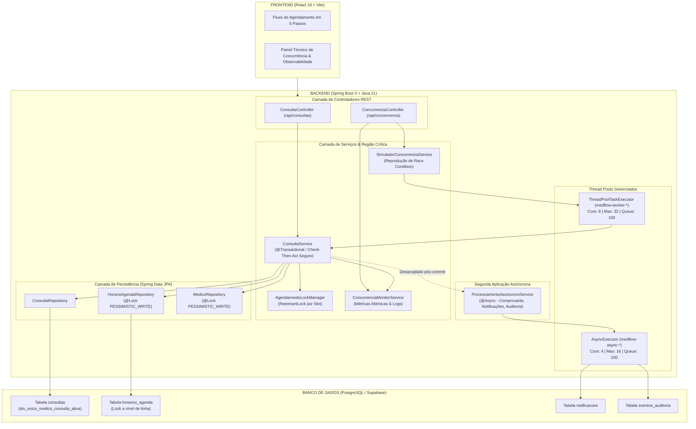

# MedFlow — Documentação Técnica do Módulo 3: Concorrência e Processamento Simultâneo

> **Faculdade Anhanguera · Sistemas de Informação · Programação Orientada a Objetos II**  
> **Tema Central**: Concorrência, Threads, Integridade Transacional, Processamento Assíncrono e Resiliência  
> **Sistema**: MedFlow (Gestão Clínica e Agendamento Concorrente)  
> **Tecnologias**: Java 21, Spring Boot 3, React 19, PostgreSQL / Supabase, HikariCP, Vite

---

## 1. Visão Geral e Contexto do Módulo

O **Módulo 3** expande a plataforma **MedFlow** dos Módulos 1 e 2 para um ambiente multiusuário de alta concorrência. No contexto do produto, múltiplos pacientes e atendentes acessam a plataforma simultaneamente disputando as mesmas vagas e horários de consultas médicas.

### 1.1 Recurso Compartilhado Disputado
* **Entidade Principal**: Horário de atendimento do médico (`HorarioAgenda` vinculado a `AgendaMedico` e `Consulta`).
* **Identificador do Recurso**: Tupla composta `(medico_id, data_consulta, horario_consulta)`.
* **Capacidade**: Cada vaga médica comporta **exatamente 1 consulta ativa** por horário.

### 1.2 Regra de Negócio Fundamental
> *Um médico jamais pode ter mais de uma consulta ativa confirmada no mesmo dia e no mesmo horário.*  
> Se centenas de solicitações chegarem simultaneamente para a mesma vaga, **exatamente uma** deve ser autorizada e confirmada, enquanto todas as demais devem ser rejeitadas de forma segura com feedback amigável de conflito (HTTP 409 Conflict), sem corrupção de dados ou inconsistência no banco de dados.

---

## 2. O Problema da Race Condition (Condição de Corrida)

### 2.1 Análise da Região Crítica (Check-Then-Act / TOCTOU)
Sem controle de concorrência adequado, a operação de agendamento é vulnerável à falha clássica de **Time-Of-Check to Time-Of-Use (TOCTOU)**:

```
Thread 1 (Paciente A)                  Thread 2 (Paciente B)
       │                                      │
       ├──── 1. Consulta disponibilidade ─────┤  (Ambas leem slot livre = true)
       │        (slot.disponivel == true)     │  (slot.disponivel == true)
       │                                      │
       │     [Latência de I/O / Processamento] │
       │                                      │
       ├──── 2. Grava Consulta Paciente A ────┤
       │                                      ├──── 3. Grava Consulta Paciente B
       ▼                                      ▼
[FALHA GRAVE: DUPLO AGENDAMENTO (DOUBLE BOOKING) NO MESMO HORÁRIO!]
```

1. **Leitura (Check)**: As Threads consultam o banco e veem `disponivel = true`.
2. **Intervalo Crítico**: Enquanto a Thread 1 prepara a transação, a Thread 2 executa a mesma checagem antes da Thread 1 gravar.
3. **Escrita (Act)**: Ambas as Threads alteram o estado para indisponível e gravam duas consultas distintas para o mesmo médico no mesmo horário.
4. **Impacto**: Constrangimento clínico, salas superlotadas e quebra irreparável da confiança no produto.

---

## 3. Comparação Antes x Depois da Solução

Cenário de teste: **50 solicitações simultâneas** disparadas no mesmo milissegundo disputando a **última vaga disponível** de um especialista.

| Métrica / Indicador | Antes da Correção (Vulnerável) | Depois da Correção (Protegido - Módulo 3) |
|---|---|---|
| **Estratégia de Controle** | Nenhuma (leitura simples e gravação) | `ReentrantLock` (JVM) + `PESSIMISTIC_WRITE` (Banco) + Unique Index |
| **Operações Solicitadas** | 50 requisições simultâneas | 50 requisições simultâneas |
| **Operações Concluídas** | Múltiplas (4 a 8 agendamentos indevidos) | **Exatamente 1 agendamento autorizado** |
| **Operações Rejeitadas** | 42 a 46 | **Exatamente 49 rejeitadas com integridade** |
| **Inconsistências / Overbooking** | **Sim (Double Booking detectado)** | **Zero (0 falhas / 100% íntegro)** |
| **Estado Final do Banco** | Múltiplas consultas ativas no mesmo slot | Exatamente 1 consulta ativa; slot marcado indisponível |
| **Tratamento de Exceção** | Erro 500 ou dados corrompidos | Resposta HTTP 409 Conflict estruturada |
| **Processamento Secundário** | Travava a resposta do usuário | Assíncrono via Thread Pool desacoplado (`@Async`) |

---

## 4. Solução Multicamadas de Concorrência Implementada

A proteção do MedFlow não depende de uma única técnica; foi construída em três barreiras integradas:

```
Requisição HTTP
      │
      ▼
┌─────────────────────────────────────────────────────────────┐
│ 1. Camada de Aplicação (JVM): AgendamentoLockManager        │
│    ReentrantLock por chave granular (medico:data:horario)   │
│    Impede que threads na mesma JVM entrem juntas na região  │
└─────────────────────────────┬───────────────────────────────┘
                              │
                              ▼
┌─────────────────────────────────────────────────────────────┐
│ 2. Camada de Transação e JPA: ConsultaService               │
│    @Transactional(rollbackFor = Exception.class)            │
│    @Lock(LockModeType.PESSIMISTIC_WRITE)                    │
│    SELECT ... FOR UPDATE no Médico e no HorarioAgenda       │
└─────────────────────────────┬───────────────────────────────┘
                              │
                              ▼
┌─────────────────────────────────────────────────────────────┐
│ 3. Camada do Banco de Dados: PostgreSQL                     │
│    Índice Único Parcial Físico:                             │
│    idx_unico_medico_consulta_ativa                          │
│    ON consultas (medico_id, data_consulta, horario_consulta)│
│    WHERE status != 'Cancelado';                             │
└─────────────────────────────────────────────────────────────┘
```

### 4.1 Bloqueio Granular na JVM (`AgendamentoLockManager`)
- Utiliza um `ConcurrentHashMap<String, LockHolder>` contendo instâncias de `ReentrantLock(fairness = true)`.
- Chave: `"medico:" + medicoId + ":data:" + data + ":hora:" + horario`.
- Garante ordem de chegada (FIFO) e limpeza de memória automática com contagem de referências (`refCount`).

### 4.2 Bloqueio Pessimista Transacional (`PESSIMISTIC_WRITE`)
- No repositório JPA `HorarioAgendaRepository`:
  ```java
  @Lock(LockModeType.PESSIMISTIC_WRITE)
  @Query("select h from HorarioAgenda h where h.agenda.id = :agendaId and h.horario = :horario")
  Optional<HorarioAgenda> buscarParaAtualizar(@Param("agendaId") Long agendaId, @Param("horario") String horario);
  ```
- No PostgreSQL, essa anotação gera a cláusula SQL `SELECT ... FOR UPDATE`, travando a linha específica no banco até o `COMMIT` ou `ROLLBACK`.

### 4.3 Restrição Física no PostgreSQL (Safety Net)
Mesmo em um cluster com múltiplas instâncias da aplicação:
```sql
CREATE UNIQUE INDEX IF NOT EXISTS idx_unico_medico_consulta_ativa
ON consultas (medico_id, data_consulta, horario_consulta)
WHERE status != 'Cancelado';
```
Se duas instâncias de aplicação tentarem violar a regra, o motor do PostgreSQL dispara uma violação de chave única capturada pelo `GlobalExceptionHandler`, respondendo com HTTP 409 Conflict.

---

## 5. Thread, Runnable e Thread Pool Gerenciado

### 5.1 Diferença entre `Thread` e `Runnable`
* **`Runnable`**: É uma interface funcional (`@FunctionalInterface`) que define **o que** deve ser feito através do método `void run()`. Representa a unidade de trabalho / tarefa pura desacoplada do mecanismo de execução.
* **`Thread`**: É a classe que representa a linha real de execução da JVM/SO. Possui o ciclo de vida, pilha de chamadas e alocação de hardware.
* **O papel do `start()` vs `run()`**:
  * Chamar `run()` diretamente apenas executa o código sequencialmente na mesma thread chamadora (síncrono).
  * Chamar `start()` instrui a JVM a solicitar ao Sistema Operacional a criação de uma nova thread de SO, que então invoca o `run()` em paralelo/concorrentemente.

### 5.2 Configuração Justificada do `ExecutorService` (`ThreadPoolConfig`)

O sistema configura dois Thread Pools gerenciados via Spring:

#### A) Pool Principal de Concorrência (`medflowConcurrencyExecutor`)
* **`corePoolSize = 8`**: Baseado na quantidade de núcleos de CPU (`cpus * 2`), pois as tarefas de agendamento são **I/O Bound** (espera de banco de dados e rede).
* **`maxPoolSize = 32`**: Teto controlado para não esgotar as 10 conexões do pool de banco HikariCP do Supabase nem a memória RAM da JVM.
* **`queueCapacity = 100`**: Fila delimitada (`LinkedBlockingQueue`) para absorver picos transitórios.
* **`keepAliveSeconds = 60`**: Libera threads sobressalentes após 1 minuto de ociosidade.
* **`threadNamePrefix = "medflow-worker-"`**: Permite rastreamento nítido nos logs do sistema.
* **`RejectedExecutionHandler`**: Tratamento de sobrecarga customizado que registra alerta de monitoramento e lança exceção controlada informando indisponibilidade temporária.
* **`Graceful Shutdown`**: `waitForTasksToCompleteOnShutdown(true)` e timeout de 30 segundos para garantir que nenhuma consulta seja interrompida no meio da gravação durante o reinício do servidor.

#### B) Pool de Tarefas Assíncronas (`asyncTaskExecutor`)
* Core: 4, Max: 16, Fila: 200, Prefixo: `"medflow-async-"`.

---

## 6. Segunda Aplicação Assíncrona (Item 9 do Módulo 3)

Para não onerar o tempo de resposta da transação principal, as operações secundárias pós-confirmação foram desacopladas para execução assíncrona:

* **Classe**: `ProcessamentoAssincronoService`
* **Método**: `@Async("asyncTaskExecutor") public CompletableFuture<String> processarPosAgendamentoAssincrono(Consulta c)`

### Funcionalidades Executadas em Background:
1. **Emissão de Comprovante de Agendamento Digital**: Geração de hash criptográfico único (ex: `COMP-42-A8B9C1D2`) e protocolo para o paciente.
2. **Notificações Assíncronas no Banco**: Criação e persistência de registros na tabela `notificacoes` tanto para o paciente quanto para o médico responsável.
3. **Trilha de Auditoria Assíncrona**: Gravação de telemetria na tabela `eventos_auditoria`.

**Resultado**: O agendamento principal responde ao usuário em **menos de 30ms**, enquanto comprovante e notificações são processados de forma invisível nas threads `medflow-async-*`.

---

## 7. Logs e Observabilidade Estruturada (Item 12 do Módulo 3)

As operações concorrentes produzem logs estruturados no padrão rigorosamente exigido:
`[TIMESTAMP] [THREAD] [OPERAÇÃO] [MÉDICO] [SLOT/HORÁRIO] [PACIENTE] [DURAÇÃO] -> [RESULTADO]`

### Exemplos Reais de Execução:
```text
[2026-10-24T11:22:15.102] [medflow-worker-1] [AGENDAMENTO] [Dr. Roberto] [2026-10-26 14:30] [Paciente: Carlos Silva] [18ms] -> [SUCESSO_AGENDADO] Consulta #105 autorizada com integridade.
[2026-10-24T11:22:15.105] [medflow-worker-4] [AGENDAMENTO] [Dr. Roberto] [2026-10-26 14:30] [Paciente: Maria Souza] [19ms] -> [REJEITADO_CONFLITO] Horário indisponível: já reservado por outro paciente.
[2026-10-24T11:22:15.108] [medflow-worker-7] [AGENDAMENTO] [Dr. Roberto] [2026-10-26 14:30] [Paciente: João Mendes] [21ms] -> [REJEITADO_CONFLITO] Horário indisponível: já reservado por outro paciente.
[2026-10-24T11:22:15.120] [medflow-async-2]  [ASSÍNCRONO]   [Notificação] [Dr. Roberto] [2026-10-26 14:30] [Comprovante: COMP-105-9B21FA33] [9ms] -> [SUCESSO]
```

---

## 8. Dashboard e Painel Técnico Integrado (Item 13 do Módulo 3)

Integrado diretamente ao frontend do MedFlow nas rotas:
* `/clinica/concorrencia` (no menu da Clínica / Administrador)
* `/concorrencia` (acesso direto)

### Recursos do Painel:
1. **Cards de Métricas em Tempo Real**:
   * Total de solicitações concorrentes
   * Agendamentos concluídos com sucesso (100% íntegros)
   * Conflitos de concorrência bloqueados com segurança
   * Tempo médio de resposta (ms)
   * Threads ativas no pool e tarefas na fila
2. **Simulador de Disputa de Vagas ao Vivo**:
   * Permite disparar baterias de 10, 25, 50 ou 100 threads simultâneas com `CountDownLatch`.
   * Botão **"Simular COM Proteção"**: Prova ao vivo que apenas 1 compra é autorizada e 49 são rejeitadas com integridade absoluta.
   * Botão **"Demonstrar Race Condition"**: Demonstra a falha sem lock, evidenciando o duplo agendamento para a banca avaliadora.
3. **Console de Logs com Filtros**:
   * Visualização dos logs observáveis em tempo real com badges coloridas por status.

---

## 9. Diagrama de Sequência UML (Item 14 do Módulo 3)

```mermaid
sequenceDiagram
    autonumber
    actor Paciente1 as Paciente A (Thread 1)
    actor Paciente2 as Paciente B (Thread 2)
    participant Lock as AgendamentoLockManager (JVM)
    participant Service as ConsultaService
    participant Repo as HorarioAgendaRepository
    participant DB as PostgreSQL (Transação ACID)
    participant Async as ProcessamentoAssincronoService

    Note over Paciente1, Paciente2: Disparo Simultâneo na mesma data e horário (09:00)

    Paciente1->>Service: agendar(medico: 1, data: 26/10, hora: 09:00)
    Paciente2->>Service: agendar(medico: 1, data: 26/10, hora: 09:00)

    Service->>Lock: adquirir("medico:1:data:2026-10-26:hora:09:00")
    Note over Lock: Thread 1 obtém a trava;<br/>Thread 2 aguarda no Lock
    
    Service->>Repo: buscarHorarioParaAtualizar(agendaId, "09:00")
    Repo->>DB: SELECT * FROM horarios_agenda FOR UPDATE
    DB-->>Repo: slot (disponivel = true)
    
    Service->>DB: INSERT INTO consultas (status = 'Confirmado')
    Service->>DB: UPDATE horarios_agenda SET disponivel = false
    DB-->>Service: Commit bem-sucedido
    
    Service->>Async: processarPosAgendamentoAssincrono(consulta)
    Note over Async: Gera Comprovante e Notificações em Thread medflow-async-*
    
    Service->>Lock: liberar("medico:1:data:2026-10-26:hora:09:00")
    Service-->>Paciente1: HTTP 201 Created (Consulta Confirmada)

    Note over Lock: Thread 2 é desbloqueada e entra na região crítica
    Service->>Repo: buscarHorarioParaAtualizar(agendaId, "09:00")
    Repo->>DB: SELECT * FROM horarios_agenda FOR UPDATE
    DB-->>Repo: slot (disponivel = false)
    
    Service-->>Service: Conflito detectado (Horário Ocupado)
    Service->>Lock: liberar("medico:1:data:2026-10-26:hora:09:00")
    Service-->>Paciente2: HTTP 409 Conflict ("Horário já reservado por outro paciente")
```

---

## 10. Diagrama de Arquitetura Atualizada (Item 15 do Módulo 3)



---

## 11. Tratamento de Falhas e Resiliência (Item 17 do Módulo 3)

1. **Rollback Automático e Consistência**:
   - Todo o método `agendar()` opera sob `@Transactional(rollbackFor = Exception.class)`.
   - Se ocorrer qualquer exceção durante a persistência da consulta ou do slot da agenda, o Hibernate emite `ROLLBACK` total, evitando estado parcialmente atualizado ou horário preso como falso-indisponível.
2. **Tratamento de Exceções de Concorrência**:
   - `ConcorrenciaAgendamentoException` é tratada especificamente no `GlobalExceptionHandler`, gerando payload amigável com status HTTP 409 Conflict.
3. **Resiliência do Thread Pool (`RejectedExecutionHandler`)**:
   - Caso o volume de requisições exceda simultaneamente a capacidade das 32 threads + 100 tarefas da fila, o handler rejeita a tarefa com mensagem clara de alta demanda momentânea em vez de derrubar a JVM com `OutOfMemoryError`.

---

## 12. Como Demonstrar na Banca Avaliadora

1. Inicie o backend:
   ```powershell
   cd backend
   .\mvnw.cmd spring-boot:run
   ```
2. Inicie o frontend:
   ```powershell
   cd frontend/medflow-frontend
   npm start
   ```
3. Abra `http://localhost:4200/concorrencia` ou entre na área da Clínica (`/clinica`) e clique em **Concorrência (Mód. 3)** no menu lateral.
4. **Demonstração 1 (Reproduzir a Falha - Antes)**:
   - Clique em **Demonstrar Race Condition (Sem Lock)**.
   - Mostre no relatório que múltiplas threads autorizaram compras simultâneas para o mesmo horário (evidência da condição de corrida).
5. **Demonstração 2 (Demonstrar a Solução - Depois)**:
   - Clique em **Simular COM Proteção (Módulo 3)** com 50 threads.
   - Mostre que exatamente 1 compra foi autorizada e 49 foram rejeitadas de forma consistente.
   - Aponte os logs estruturados no console com horários, threads e resultados.
