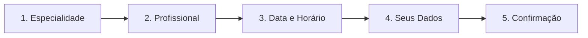

# MedFlow — Aprendizados e Guia Completo da Área do Paciente (`/paciente`)

> **Documento gerado a partir de testes automatizados e manuais interativos no navegador local (`http://127.0.0.1:4200`)**  
> **Público-Alvo**: Desenvolvedores, QA, Equipe de Produto e Avaliadores Acadêmicos

---

## 1. Visão Geral da Área do Paciente

A área do paciente (`/paciente`) é o canal de autoatendimento do MedFlow focado em simplicidade, clareza e agilidade. Permite ao usuário buscar especialidades e médicos, agendar consultas em poucos passos, acompanhar compromissos futuros, consultar histórico e gerenciar seus dados cadastrais.

### Rotas e Mapeamento de Componentes
* `/paciente` — **Início / Dashboard**: Boas-vindas personalizadas com o primeiro nome do paciente, card em destaque da próxima consulta agendada, atalhos rápidos e vitrine de especialidades.
* `/paciente/agendar` — **Agendamento de Consultas**: Fluxo wizard guiado em etapas (Especialidade ➔ Profissional ➔ Data e Horário ➔ Seus Dados ➔ Confirmação).
* `/paciente/agendamentos` — **Meus Agendamentos**: Lista de consultas futuras com crachás de status, dados do médico e modal de detalhes completos (com mapa de localização).
* `/paciente/historico` — **Histórico Clínico**: Tabela cronológica de consultas realizadas ou canceladas.
* `/paciente/notificacoes` — **Central de Notificações**: Avisos sobre confirmação, remarcação ou cancelamento de consultas.
* `/paciente/perfil` — **Meu Perfil**: Gestão de dados pessoais (nome, CPF, data de nascimento, telefone, e-mail e avatar).

---

## 2. Fluxo Completo do Wizard de Agendamento (`/paciente/agendar`)

O agendamento é estruturado em um assistente de 5 etapas com validações progressivas e painel lateral de resumo sempre visível:

### Etapa 1: Especialidade
* **Filtro em Tempo Real**: Barra de pesquisa com normalização de strings (remove acentuação e converte para minúsculas).
* **Cards de Especialidade**: Cada card exibe o ícone temático, o nome da especialidade e a quantidade de profissionais ativos vinculados.
* **Ação**: Clicar em uma especialidade seleciona o ID, limpa seleções anteriores e avança automaticamente para a Etapa 2.

### Etapa 2: Profissional
* **Filtragem por Especialidade**: Apenas médicos com `specialtyId === selectedSpecialtyId` são exibidos na grade.
* **Card do Médico**: Exibe avatar/foto, nome completo com tratamento `Dr(a).`, CRM, pontuação/avaliação, valor da consulta e duração estimada.
* **Ação**: Ao selecionar o profissional, o ID do médico é fixado e o wizard avança para a Etapa 3.

### Etapa 3: Data e Horário
* **Seletor de Data (`SeletorData.jsx`)**:
  * Calendário nativo com restrição de data mínima: `min={today()}`.
  * O paciente não consegue selecionar nenhuma data anterior ao dia atual.
* **Grade de Horários (`SeletorHorario.jsx`)**:
  * Consulta a API do backend (`GET /api/medicos/{id}/agenda/{data}`) para carregar a grade dinâmica de horários liberados pelo profissional.
  * Horários já agendados por outros pacientes são marcados como indisponíveis ou omitidos.
  * No dia de hoje (`today()`), horários anteriores ao horário corrente (`time < nowTime`) ficam desabilitados.
* **Ação**: O paciente seleciona o botão do horário desejado (ex: `12:35`) e clica em **Continuar**.

### Etapa 4: Seus Dados (Identificação)
* **Preenchimento Automático**: Se o paciente já possui conta ou está autenticado no contexto (`patientId`), os campos são pré-carregados.
* **Validações de Campo (`FormularioPaciente.jsx` / `appointments.js`)**:
  1. **Nome**: Deve ter no mínimo 3 caracteres (`"Informe seu nome completo"`).
  2. **CPF**: Máscara formatada `000.000.000-00` e validação de 11 dígitos numéricos (`"Informe os 11 dígitos do CPF"`).
  3. **Data de Nascimento**: Restrição `max={today()}`, impedindo que o paciente selecione datas futuras.
  4. **Telefone**: Deve conter DDD e no mínimo 10 dígitos numéricos (`"Informe um telefone com DDD"`).
  5. **E-mail**: Regex de e-mail válido com `@` e domínio (`"Informe um e-mail válido"`).
* **Ação**: Caso haja qualquer erro, uma mensagem de alerta em vermelho é exibida impedindo o avanço. Estando válido, avança para a confirmação.

### Etapa 5: Confirmação e Reserva
* **Painel Resumo**: Exibe detalhadamente Especialidade, Médico, Data, Horário e Paciente.
* **Botão de Submissão**: Ao clicar em **Confirmar agendamento**, o botão exibe estado de loading (`Confirmando...`) e desabilita cliques repetidos.
* **Comunicação com Backend**:
  * Dispara `POST /api/consultas` enviando `{ doctorId, patientId, date, time, status: 'Confirmado' }`.
  * Retorno com sucesso gera o ID da consulta e redireciona o paciente com feedback de sucesso.

---

## 3. Concorrência e Proteção de Horários (Módulo 3)

1. **Validação Concorrente**:
   * Quando o paciente seleciona um horário liberado e confirma, a base de dados verifica se aquele slot ainda se encontra livre.
   * Se dois pacientes tentarem reservar o mesmo horário simultaneamente, a transação garante que apenas um seja confirmado; o segundo paciente recebe aviso imediato de que o horário acabou de ser preenchido e é convidado a escolher outro slot.
2. **Atualização Imediata da Grade**:
   * Uma vez agendado, o slot reservado desaparece instantaneamente das opções disponíveis para qualquer outro paciente que consulte a mesma data e médico.

---

## 4. Gestão de Consultas e Cancelamento

### Consulta de Detalhes (`ModalDetalhesConsulta`)
* Ao clicar em "Ver detalhes" em `/paciente/agendamentos` ou `/paciente/historico`, abre-se o modal contendo:
  * Cabeçalho com data, horário e crachá de status (`Confirmado`, `Pendente`, `Em atendimento`, `Concluído`, `Cancelado`).
  * Identificação do médico, especialidade e CRM.
  * Endereço físico da clínica com mapa interativo (Leaflet/OpenStreetMap), link direto para rotas no Google Maps e botão "Copiar endereço".

### Fluxo de Cancelamento
* Em consultas futuras ativas (`status !== 'Cancelado'`), é exibido o botão **Cancelar**.
* Ao clicar, surge o diálogo de confirmação (`ModalConfirmacao`):
  * **"Manter consulta"**: Fecha o modal sem alterar o estado.
  * **"Confirmar cancelamento"**: Dispara a atualização para `status = 'Cancelado'`.
* **Efeito no Sistema**:
  * O status da consulta passa a `Cancelado`.
  * A consulta sai da aba "Próximos" e é movida para "Histórico".
  * O horário é liberado de volta na agenda do médico, permitindo que outros pacientes possam agendá-lo novamente.

---

## 5. Perfil do Paciente (`/paciente/perfil`)

* Permite atualizar nome completo, data de nascimento, CPF, telefone e e-mail.
* Suporta upload e remoção de foto de perfil.
* Na ausência de foto, o sistema gera dinamicamente um avatar circular com as iniciais do paciente (ex: `SP` para "Saulo Paciente").
* Bloqueia datas de nascimento futuras com `max={today()}`.

---

## 6. Responsividade Mobile

* Em viewports móveis (ex: 375px a 430px), a aplicação adapta-se com:
  * **Barra de Navegação Inferior Fixa**: Acesso a Início, Agendar, Meus Agendamentos, Notificações e Perfil.
  * **Menu Gaveta (Drawer)**: Botão "Abrir menu" no topo para opções complementares.
  * **Layout em Coluna Única**: O resumo lateral do wizard é posicionado de forma empilhada para não comprometer a leitura.
